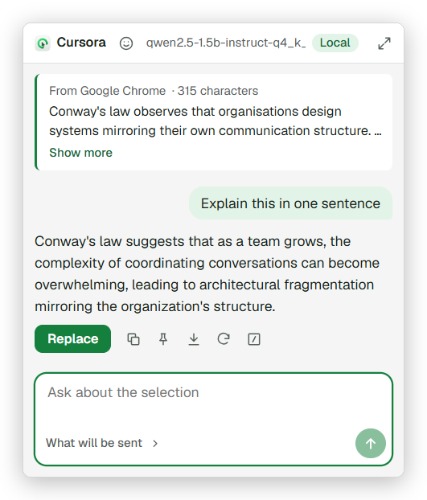
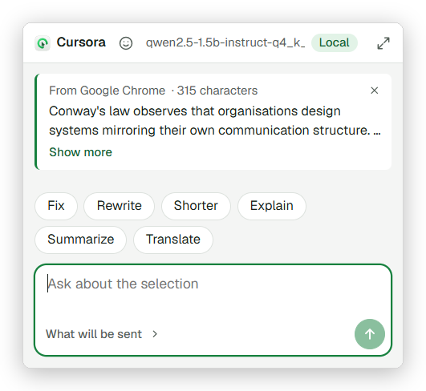
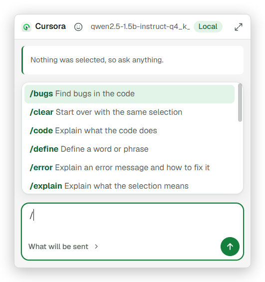
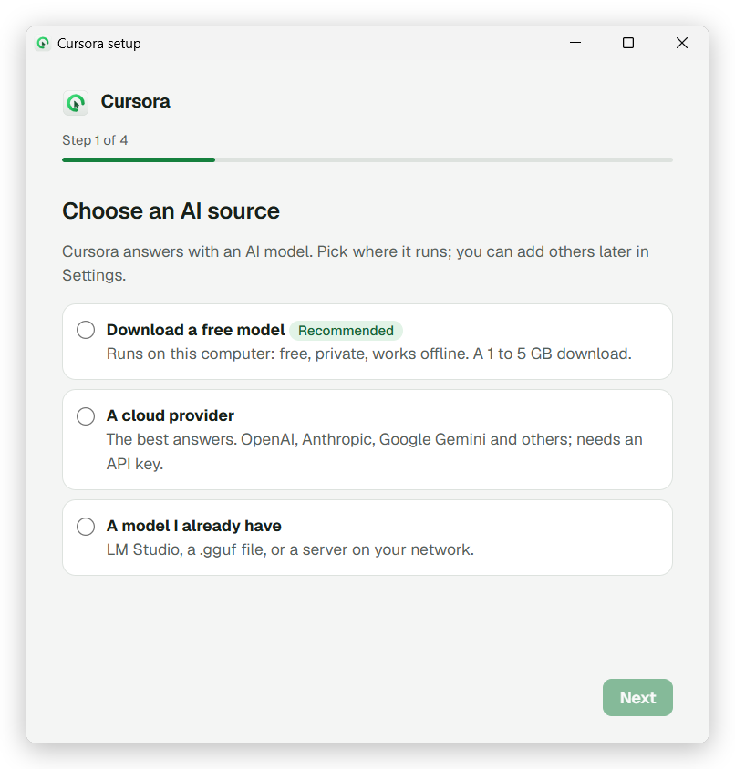
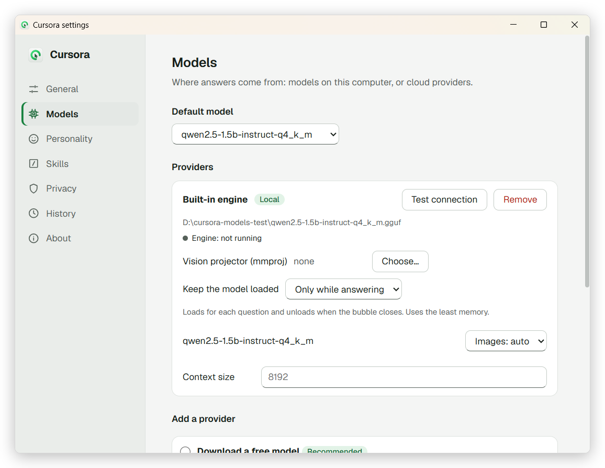
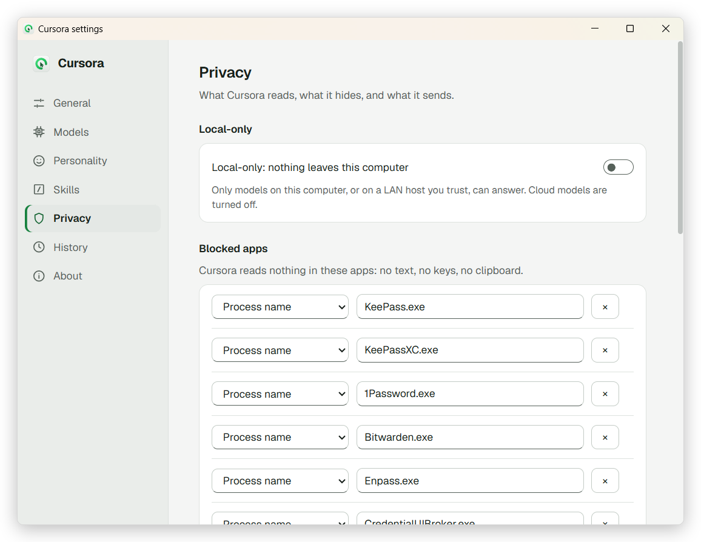

# Cursora

### Ask AI about anything you select, right where you are.

Select text in any app &nbsp;·&nbsp; press <kbd>Ctrl</kbd> + <kbd>G</kbd> &nbsp;·&nbsp; ask. 
No copying, no pasting, no switching windows.

 

&nbsp;

  

 

## How it works

<table>
<tr>
<td width="33%" valign="top">

**1. Select**

A paragraph on a web page, a sentence in a PDF, an email, an error in your terminal, a few lines of code. Even files in File Explorer.

</td>
<td width="33%" valign="top">

**2. Press <kbd>Ctrl</kbd> + <kbd>G</kbd>**

A small chat bubble opens right at your mouse, with your selection already attached. Nothing selected? It opens as a plain chat.

</td>
<td width="33%" valign="top">

**3. Ask**

Read the answer as it's written, ask a follow-up, or put the answer straight back into your app. Press <kbd>Ctrl</kbd> + <kbd>G</kbd> again and you're back where you were.

</td>
</tr>
</table>

## New in 0.2

- **Replace and Insert:** put the answer straight back into the app you were in.
- **Quick actions:** one-click buttons that suit the app your text came from.
- **A free AI model in one click,** right in the first-time setup.
- **My language:** Hindi, Hinglish, Bengali, Tamil and nine more Indian languages.
- **Pin and Save** an answer you want to keep.
- **A new look:** calmer, lighter, easier to read.

 

## Do more with what you select

<table>
<tr>
<td width="50%" valign="top">

### One click for the usual jobs

Before you type a word, the bubble offers the jobs that suit the app you're in:

- **Mail and chat:** Reply, Fix, More polite, Shorter, Translate
- **Code:** Explain, Find bugs, Explain error, Summarize
- **Terminals:** Explain error, Explain command
- **Everything else:** Fix, Rewrite, Shorter, Explain, Summarize, Translate

<kbd>Alt</kbd> + <kbd>1</kbd> to <kbd>6</kbd> press them, and your favourite skills can go first.

</td>
<td width="50%" valign="top">

</td>
</tr>
<tr>
<td width="50%" valign="top">

</td>
<td width="50%" valign="top">

### Skills, one word away

Type `/` in the bubble:

- `/summary` a few bullet points
- `/explain` what it means
- `/simplify` the same, in simpler words
- `/fix` grammar, spelling and punctuation
- `/rewrite <tone>` in another tone
- `/translate <language>` into any language
- `/reply` a reply to the message
- `/error` what went wrong, and how to fix it
- `/code` and `/bugs` explain code, or find its bugs
- `/define` a word or phrase

Make your own skills too, or save any question you asked as one.

</td>
</tr>
</table>

<table>
<tr>
<td width="50%" valign="top">

**Replace and Insert.** Fix a paragraph, shorten an email or translate a message, then press **Replace** and the answer takes the place of your selection. Nothing selected? **Insert** puts it where your cursor was. <kbd>Ctrl</kbd> + <kbd>Z</kbd> undoes it, as usual.

</td>
<td width="50%" valign="top">

**Snip anything on screen.** Press <kbd>Ctrl</kbd> + <kbd>Shift</kbd> + <kbd>G</kbd> and drag a box around a chart, an image, a video frame or a scanned page, then ask about it. Works with AI models that can read images.

</td>
</tr>
<tr>
<td width="50%" valign="top">

**Your language.** Set **My language** and the Translate button speaks it. Hindi, Hinglish (Hindi in English letters), Bengali, Marathi, Telugu, Tamil, Gujarati, Urdu, Kannada, Odia, Malayalam, Punjabi and Assamese are suggested, or type any other. Every answer can come in it too. A cloud model handles these languages best.

</td>
<td width="50%" valign="top">

**Pin and Save.** **Pin** keeps an answer on screen in a small note while you work. **Save** writes it to a Markdown file in a folder you choose, so an Obsidian vault works too.

</td>
</tr>
<tr>
<td width="50%" valign="top">

**A companion with a personality, or none.** Pick Cursora, Ada, Arjun or Sage, make your own with its own name, tone and level of detail, or turn personality off.

</td>
<td width="50%" valign="top">

**History.** Conversations stay on your computer, searchable, for 90 days unless you choose otherwise. Saving can be switched off. Press **Expand** to carry on in a bigger window.

</td>
</tr>
</table>

 

## Your model, your choice

<table>
<tr>
<td width="40%" valign="top">

The first-time setup asks one question: **where should answers come from?**

**Download a free model.** One click, and it runs on your computer: free, private, and it works offline. Cursora suggests the size that suits your PC.

- **Small,** 1.1 GB: fastest
- **Medium,** 2.5 GB: a good balance
- **Large,** 4.7 GB: best answers, slower

**A cloud provider** gives the best answers, with your own API key.

**A model you already have:** LM Studio, a `.gguf` file, or a server on your network.

</td>
<td width="60%" valign="top">

</td>
</tr>
</table>

| On your computer | In the cloud, with your own API key |
|---|---|
| **Built-in engine:** a one-click model, or any `.gguf` file. Works fully offline. | **OpenAI**, **Anthropic**, **Google Gemini** |
| **LM Studio**, found automatically | **OpenRouter**, **Groq**, **DeepSeek**, **Mistral** |
| **Any OpenAI-compatible server:** llama.cpp, vLLM, Jan, LocalAI, KoboldCpp | **Any OpenAI-compatible service** |

Add as many as you like, and switch between them from the bubble.

 

## Private by design

- **No account, no telemetry, no analytics.** Cursora talks only to the AI models you set up, plus a once-a-day update check that sends nothing about you. You can turn it off.
- **Local-only mode:** one switch, and nothing leaves your computer.
- **Personal details are hidden** before they reach a cloud model: email addresses, phone numbers, card numbers, IBANs, API keys, Aadhaar and PAN numbers. They're put back in the answer on your side, and **What will be sent** shows the exact text first.
- **Blocked apps:** Cursora never reads password managers, and you can block any other app.
- **API keys stay in your system's keychain**, never in a file or a log.
- **Your clipboard is left as it was**, and programs running in a terminal are never interrupted.

 

## Download

| Your system | File |
|---|---|
| **Windows 10 / 11** (64-bit) | `Cursora_<version>_x64_en-US.msi` |
| **Ubuntu, Debian** (beta) | `Cursora_<version>_amd64.deb` |
| **Fedora** (beta) | `Cursora-<version>-1.x86_64.rpm` |
| **Any other Linux** (beta) | `Cursora_<version>_amd64.AppImage` |

Get them from the **[latest release](https://github.com/priyansh1210/cursora-releases/releases/latest)**. Each one includes Cursora's built-in AI engine, so there's nothing else to install. After that, Cursora keeps itself up to date: when a new version is out, it says so in its tray menu, and one click installs it.

> [!NOTE]
> **Windows may say "Windows protected your PC"** when you open the installer. Cursora is new and its installer isn't signed with a paid certificate yet, so Windows doesn't recognise it. Click **More info**, then **Run anyway**.

## Getting started

1. Install Cursora for your system from the [latest release](https://github.com/priyansh1210/cursora-releases/releases/latest).
2. Follow the short setup: choose a model, a personality and your hotkeys.
3. Select some text anywhere and press <kbd>Ctrl</kbd> + <kbd>G</kbd>.

<b>Tips</b>

 

- <kbd>Ctrl</kbd> + <kbd>G</kbd> is "Go to line" in some editors. Choose another hotkey in **Settings → General**.
- To read apps that run as administrator, turn on **Settings → General → Run as administrator** (Windows, installed from the `.msi`).
- On Linux with GNOME, the tray icon needs the AppIndicator extension (Ubuntu has it). Everything also works without it.
- On Wayland, bind `cursora --ask` to a keyboard shortcut in your desktop's settings. Settings → General shows the exact command.

<b>Windows and Linux, side by side</b>

 

| | Windows 10 / 11 | Linux (X11) | Linux (Wayland) |
|---|:---:|:---:|:---:|
| Hotkey | Yes | Yes | Through a desktop shortcut |
| Selected text | Yes | Yes | Yes, with `wl-clipboard` |
| Selected files | Yes | Yes | No |
| Bubble at the cursor | Yes | Yes | Centred on screen |
| Replace and Insert | Yes | Yes | No |
| Snip | Yes | Yes | From a copied screenshot |

<b>Questions</b>

 

**What does a model cost?** Models on your computer are free. A cloud provider bills you for your own API key, as it would anywhere else.

**Does it work offline?** Yes, with the built-in engine or another model on your computer.

**Does Cursora read everything I do?** No. It reads your selection, and the name of the app it's in, only when you press the hotkey.

**Which model should I pick?** Start with the free download that Cursora suggests. For the best answers, and for Indian languages, add a cloud provider.

## About this page

This repository hosts Cursora's installers and the small file its updater reads. Each installer comes with a `.sig` signature, so Cursora installs an update only if its developer signed it. Cursora's source code is not public.

Cursora is young (version 0.2) and improving quickly. Found a problem or have an idea? **[Open an issue](https://github.com/priyansh1210/cursora-releases/issues).**

 
Made with Tauri, Rust and React.

